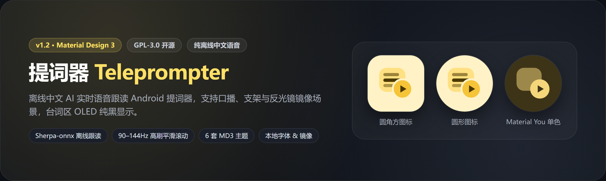
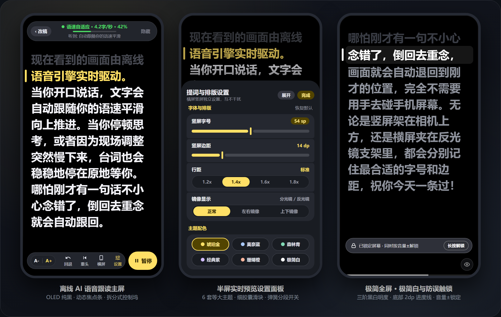

# Android Teleprompter（提词器）

一款简洁好用的 **纯中文离线 AI 实时语音跟读 Android 提词器**，适用于日常口播、相机支架与反光镜提词场景，采用 Material Design 3 设计语言。

## 界面预览



## 核心特性

- **纯离线中文语音跟读**：内置 `Sherpa-onnx` 中文流式 Zipformer 语音识别 + 无声调模糊拼音局部对齐引擎，支持语速自适应、精准锚点与备用匀速三种模式，断网环境依然稳定跟读。
- **防串行、防乱跳与高刷平滑滚屏**：
  - 自动请求设备当前分辨率最高刷新率（90/120/144Hz），帧同步阻尼平滑追赶；
  - 支持上方保留已读行数（0 / 1 / 2 行）、动态缩放居中左侧焦点条、暂停自由拖动、NG 重念自动回退、点击任意文字跳转，以及跟读中拖动自动回位轻提示（带一键暂停）。
- **实用拍摄与反光镜适配**：
  - **镜像显示**：支持 `正常 / 左右镜像 / 上下镜像`，仅镜像正文与焦点条，控制栏与设置面板保持正向可读；
  - **横屏方向锁定**：放进提词器支架或反光镜平放时防止重力意外翻转 180°；
  - **挖孔 / 刘海避让开关**：默认避让挖孔，无挖孔全面屏可关闭实现 100% 满屏显示；
  - **硬件防误触屏幕锁**：同时短按 `音量+` 与 `音量-` 一键锁定/解锁屏幕触控（底部浮层附带 0.8 秒「长按解锁」应急兜底）；单按 `音量+` 暂停/继续、`音量-` 回退一句。
- **排版与个性化**：
  - **横竖屏独立记忆**：字号（32~80 sp，支持 `A-/A+` 与双指捏合）与左右安全边距横竖屏独立保存，支持一键恢复默认排版；
  - **本地字体导入**：支持通过系统文件选择器导入本地 `.ttf` / `.otf` 字体并一键恢复系统默认；
  - **行距四档 & 字体粗细**：`1.2x / 1.4x / 1.6x / 1.8x`、常规/加粗，均配备弹簧滑块动效。
- **Material Design 3 Expressive 视觉与交互**：
  - 台词区恒为 OLED 纯黑 `#000000`，隐藏控制栏后零遮挡（双击屏幕或点击右下角淡透图标恢复），底部贴边 `2dp` 极细进度条可开关；
  - 6 款等宽等高 3×2 MD3 主题色（琥珀金 / 莫奈蓝 / 森林青 / 经典紫 / 珊瑚橙 / 三阶黑白明度「极简白」）；
  - `MD3-C`「叠色几何对话 · 暖琥珀」自适应矢量图标，完整支持 Android 13+ Material You 单色主题图标。

## 本地编译准备（离线模型未入库）

由于 `encoder.int8.onnx`（153 MB）超过 GitHub 单文件 100 MB 限制，模型文件与 `sherpa-onnx` AAR 已在 `.gitignore` 中排除。本地编译前请准备：

1. 将 `sherpa-onnx-2.0.1.aar` 放入 `app/libs/`
2. 将中文流式 Zipformer ONNX 模型文件（`encoder.int8.onnx`、`decoder.onnx`、`joiner.int8.onnx`，以及已入库的 `tokens.txt`）放入 `app/src/main/assets/asr_zh/`

```bash
./gradlew testDebugUnitTest assembleDebug
```

## 致谢与第三方开源组件

- [k2-fsa/sherpa-onnx](https://github.com/k2-fsa/sherpa-onnx) (Apache-2.0) — 离线流式语音识别引擎
- [Jetpack Compose & Material 3](https://developer.android.com/compose) (Apache-2.0) — Android 声明式 UI 框架
- [pinyin4j](https://github.com/belerweb/pinyin4j) (GPL-2.0) — 汉字转拼音工具

## 开源协议

本项目基于 [GNU General Public License v3.0 (GPL-3.0)](LICENSE) 协议开源。

Copyright © 2026 **YukokuSuzuko**.
